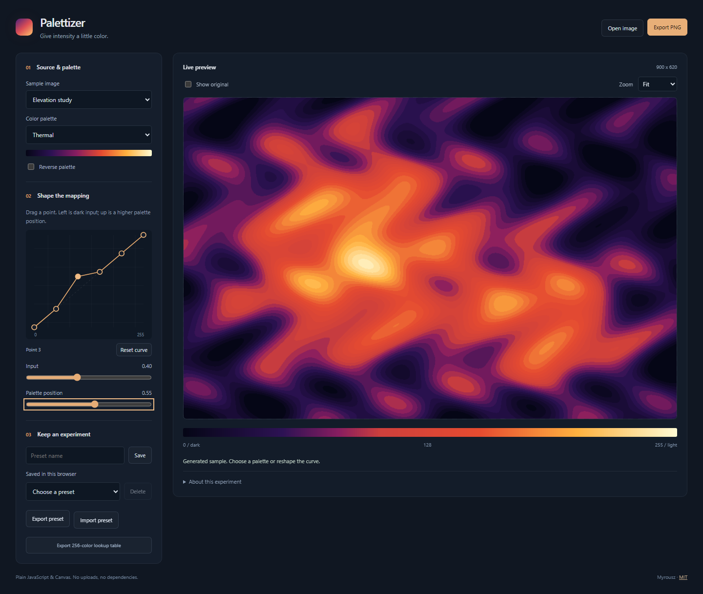

# Palettizer

A static revival of my old interactive palette-warping experiment. Map grayscale
intensities to color and reshape the mapping with a six-point transfer curve.
The new interface uses plain JavaScript, Canvas and SVG, with no dependencies.

Open **index.html** directly in a browser. No server, installation, build step,
or network connection is needed. The root web files also work on any static host.

Choose one of three generated samples or open a local image. Pick a palette,
reverse its direction, or drag an interior curve point. Curve input runs from
dark to light on the horizontal axis; output palette position increases upward.
Endpoints stay fixed, and interior points cannot cross each other. Select a
point and use its sliders, or focus a handle and use arrow keys (Shift for larger
steps). The original Sokoloff lookup table is retained alongside new palettes.

The original tool warped its lookup table using an inverse curve. This version
uses a direct input-to-palette curve so moving a point up selects a higher color.
Legacy preset arrays are not imported automatically; exported version-1 presets
are validated before use.

Show original temporarily compares the unmodified input. Zoom offers fit, 100%
and 200%. Export PNG always exports the mapped image with transparency preserved.
Color inputs are converted to intensity using weighted RGB luminance. Images
larger than 2048 pixels on either edge are resized for this prototype; the PNG
uses that processed resolution. Maximum input file size is 40 MB.

Named presets are saved locally in your browser when storage is available.
Import/export JSON presets to share mapping settings, or export a 256-color RGB
lookup table. Presets contain palette/curve settings, not source image pixels.
All processing stays in your browser. Browser storage on file URLs can vary;
JSON export is the portable way to retain a preset.

The app is self-contained in this folder. Generated samples and the screenshot
use a procedural elevation study; no historical image dataset is bundled.

Source code and procedural samples: [MIT License](LICENSE),
copyright 2026 Myrousz.

For development, run `node test-color.cjs` for lookup-table and curve checks.
Node is only needed for tests; using the app requires just a browser.
